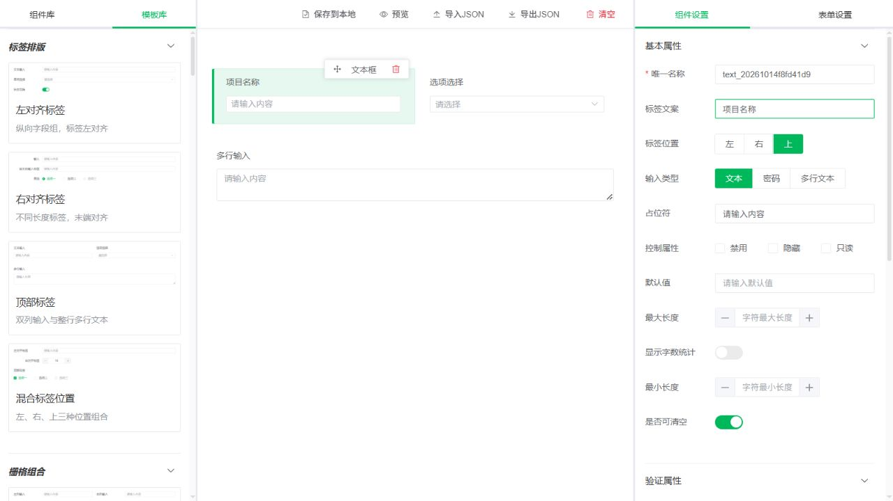
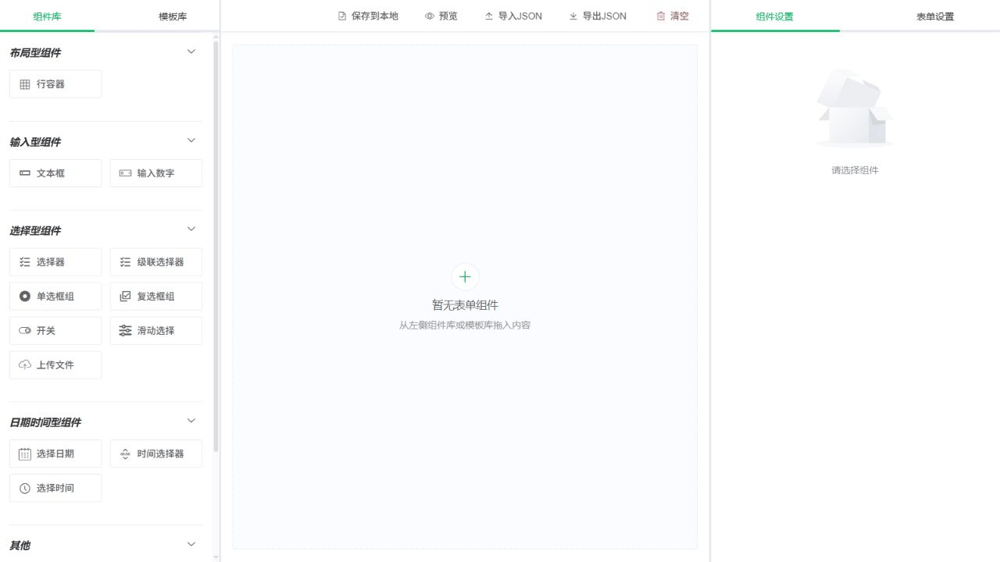
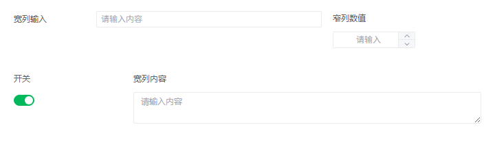
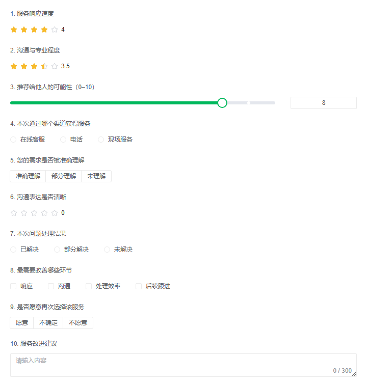
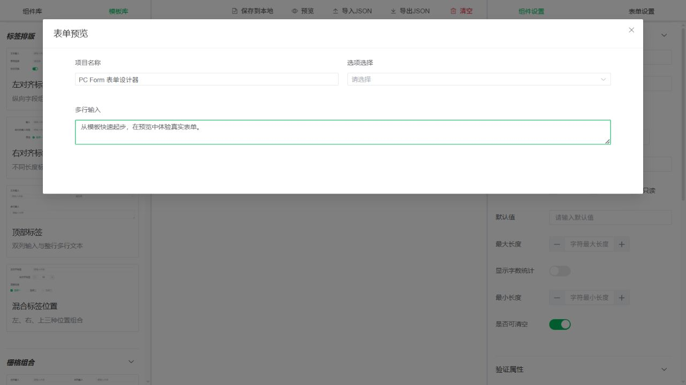

<div align="center">

# PC Form

### 拖拽搭建，让表单设计看得见、改得动、存得下。

基于 **Vue 3 · TypeScript · Element Plus** 的开源 PC 表单设计器。  
从一个字段到一组业务区块，用可视化配置完成布局，用动态脚本补充交互，再通过 JSON 保存和复用设计。

[](https://vuejs.org/)
[](https://www.typescriptlang.org/)
[](https://vite.dev/)
[](./LICENSE)
[](https://github.com/yujinjin/web-designer/stargazers)

**[在线体验 →](https://yujinjin.github.io/pc-form/)** · [快速开始](#快速开始) · [技术与结构](#技术与结构) · [反馈建议](https://github.com/yujinjin/web-designer/issues)

</div>



## 先看它怎么用

从模板库拖入一组组件，修改标签，打开预览并填写表单。以下 GIF 由本项目本地运行时的连续操作截图制作，展示实际操作步骤。



打开 **[在线设计器](https://yujinjin.github.io/pc-form/)**，无需先搭建后端即可体验表单设计。建议使用桌面浏览器。

## 为什么试试 PC Form？

- **从拖一个组件，到拖一整块表单。** 内置 18 种组件和 34 组模板，既能从空白搭建，也能直接复用布局、行业区块和问卷。
- **布局不止一种。** 支持左、右、顶部标签及混合排版；行容器支持 24 栅格、自动均分、手动列宽和换行，让表单适应不同内容密度。
- **配置与交互都能表达。** 在设置面板调整默认值、选项、校验和控件属性；通过 Monaco Editor 编写事件及动态属性脚本，实现字段联动。
- **预览里能真正操作。** 弹窗渲染实际表单，执行 `onInit`、事件和动态函数；预览使用独立数据副本，试填不改动设计源数据。
- **设计可以带走。** 手动保存到浏览器本地，下次进入询问是否恢复；也可导出 JSON 文件，在其他浏览器或设备重新导入。
- **面向扩展组织源码。** 组件注册表、属性适配器、文档处理和预览运行时各有边界，方便学习实现或继续添加组件。

## 组件与模板

### 18 种组件，覆盖输入、选择、布局与展示

| 类别       | 组件与典型配置                             |
| ---------- | ------------------------------------------ |
| 文本与数值 | 文本框（普通、密码、多行）、数字输入框     |
| 选项与层级 | 单选框组、复选框组、下拉选择器、级联选择器 |
| 日期与时间 | 日期选择器、时间选择器、固定步长时间选择   |
| 交互控件   | 开关、滑块、评分、颜色选择、文件上传       |
| 内容与布局 | HTML、提示信息、分隔线、行容器             |

选项组件支持多种展示形态，上传组件支持文件列表、图片卡片和拖拽样式。级联选择器通过可换行、可缩进的 JSON 配置完整选项树，并检查数据结构。

### 34 组模板，用图片找到你需要的起点

模板库展示真实表单预览 PNG。拖入后添加的是可独立编辑的组件列表，而不是一张图片或不可拆分的黑盒。

| 模板类型       | 数量 | 示例                                                                   |
| -------------- | ---- | ---------------------------------------------------------------------- |
| 配置与布局示例 | 18   | 混合标签、宽窄混排、选项形态、日期范围、上传形态、显隐与校验           |
| 行业区块       | 8    | 电商、物流、教育、医疗、酒店、制造质检、房产、人事                     |
| 问卷模板       | 8    | 满意度、产品反馈、服务体验、培训、活动、员工意见、需求优先级、分支问卷 |

<details>
<summary>展开查看模板效果：布局、选项与问卷</summary>

**宽窄混排：让不同内容使用合适的列宽。**



**普通与按钮选项：同一类输入，也能有不同表达。**


**服务体验评价：评分、推荐度、选项与开放式回答组合。**



</details>

## 从设计到复用

1. **搭建**：从组件库或模板库拖入内容，排序、复制、删除，在行容器中组织字段。
2. **配置**：选择组件，在右侧设置标签、默认值、选项、控制属性、验证规则及脚本；可拖动三栏分隔线调整工作空间。
3. **预览**：打开预览弹窗，检查布局、输入体验、显隐联动和校验逻辑。
4. **保存**：点击“保存到本地”保留当前设计，或使用“导出JSON”生成文件。
5. **继续编辑**：下次访问时确认恢复本地草稿，或通过“导入JSON”载入设计文件。



### JSON 是设计源，运行属性按需重建

本地保存与 JSON 文件导出使用同一套带版本号的文档格式，包含 `schemaVersion`、`savedAt` 和 `form`。

`form` 保存表单及组件配置。序列化时递归排除 `componentAttributes`，载入时根据设置与脚本重新生成运行属性，让持久化数据与运行状态分开维护。

导出内容是**表单设计文档**，用于恢复布局和配置；它不是用户填写结果，也不是生成的 Vue 源码。

## 快速开始

需要 **Node.js 22 或更高版本**，以下使用 npm。

```bash
git clone https://github.com/yujinjin/web-designer.git
cd web-designer
npm ci
npm run dev
```

访问终端中显示的本地地址。默认开发端口为 `8081`，占用时以 Vite 实际输出为准。

| 命令                       | 用途                                |
| -------------------------- | ----------------------------------- |
| `npm run dev`              | 启动本地开发服务                    |
| `npm run build`            | 执行类型检查并输出静态文件到 `dist` |
| `npm run preview`          | 本地查看构建产物                    |
| `npm run test:unit`        | 运行单元测试                        |
| `npm run test:views`       | 运行设计器相关单元测试              |
| `npm run test:views:types` | 检查设计器类型契约                  |
| `npm run test:views:check` | 检查设计器测试代码类型              |
| `npm run lint`             | 检查代码规范                        |

项目使用一套环境配置：公共配置放在 `.env`，本机覆盖放在不入库的 `.env.local`。涉及上传等接口能力时，请配置自己的服务地址。

### 静态部署

当前构建部署前缀为 **`/pc-form/`**，对应在线地址：

**https://yujinjin.github.io/pc-form/**

将 `dist` 内容部署到该路径即可。部署到其他子路径时，需要调整 `vite.config.ts` 的构建 `base`。

Monaco worker 的物理输出目录为 `dist/monacoeditorwork/`，当前运行时请求路径为 `/pc-form/monacoeditorwork/`；部署时请完整保留这些文件。

## 技术与结构

| 技术                 | 在项目中的作用                     |
| -------------------- | ---------------------------------- |
| Vue 3 + TypeScript   | 组件开发、响应式状态与类型契约     |
| Vite                 | 本地开发、模块处理与静态构建       |
| Element Plus + Icons | 表单控件、弹窗、设置面板与分隔布局 |
| Pinia + VueUse       | 状态管理与组合式工具               |
| SortableJS           | 组件及模板拖入、画布排序           |
| Monaco Editor        | 动态脚本编辑                       |
| DOMPurify            | HTML 内容安全检查                  |
| Vitest + happy-dom   | 领域逻辑与组件行为测试             |

```text
src/
├── views/
│   ├── app.vue                   # 设计器入口与页面编排
│   ├── components/
│   │   ├── workspace/            # 工作空间与组件/模板库
│   │   ├── canvas/               # 设计画布与行容器
│   │   ├── rendering/            # 组件渲染
│   │   ├── settings/             # 组件及表单设置
│   │   └── preview/              # 预览弹窗与错误边界
│   ├── composables/              # Vue 状态及交互编排
│   ├── domain/
│   │   ├── widgets/              # 注册表、树操作、组件适配器
│   │   ├── form/                 # 表单领域逻辑
│   │   ├── document/             # 文档校验、序列化与恢复
│   │   ├── preview/              # 预览运行时
│   │   └── templates/            # 模板目录与组件工厂
│   ├── types/                    # 设计器类型
│   └── utils/                    # 通用辅助方法
├── assets/                       # 样式、图标与模板预览图
└── stores/                       # 状态与存储
tests/unit/                       # 集中维护的单元测试
docs/images/                      # README 截图与演示 GIF
```

希望扩展组件时，可从 `src/views/domain/widgets/registry.ts` 与 `adapters/` 入手，再补充类型、渲染和设置面板。新增模板可参考 `src/views/domain/templates/` 中的组件工厂与目录注册方式。

## 使用边界

- **本地保存需要手动点击**，数据保存在当前浏览器的 localStorage；清理站点数据会删除草稿，不提供云同步，重要设计建议另行导出 JSON。
- 行容器最多容纳 **6 个普通组件**，不支持行容器嵌套；JSON 导入文件大小上限为 **2 MiB**。
- 预览会执行用户配置的初始化及事件脚本。预览副本用于隔离编辑数据，**不是脚本安全沙箱**，请仅导入和执行可信来源的设计。
- 导入时检查 JSON 结构及 HTML 内容，高危 HTML 会被拒绝，包含合法动态脚本或 HTML 的设计需要确认后导入。
- 项目持续迭代中，适合表单搭建、原型验证与二次开发；具体业务接口、提交与后端存储需按你的系统接入。

## 一起完善它

如果 PC Form 帮你节省了搭建表单的时间，或为你的项目提供了实现思路，欢迎点一个 **[Star ⭐](https://github.com/yujinjin/web-designer)**，让更多开发者发现它。

欢迎通过 [Issues](https://github.com/yujinjin/web-designer/issues) 反馈问题、提出组件和模板需求，也欢迎提交 PR。反馈问题时请附上复现步骤、浏览器版本，以及脱敏后的设计 JSON 或截图。

项目采用 [Apache License 2.0](./LICENSE)。
